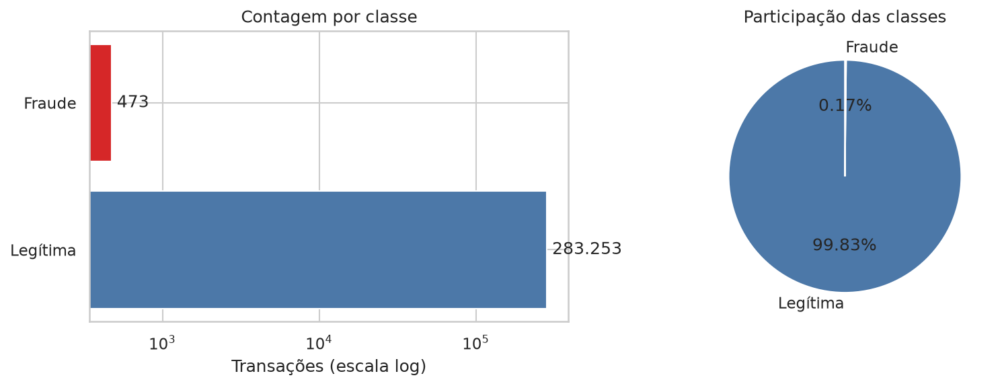
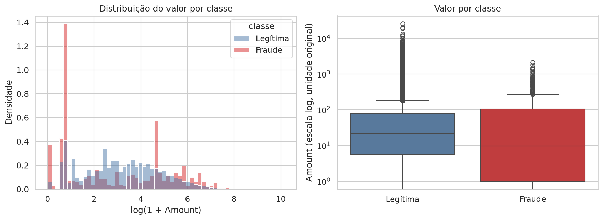
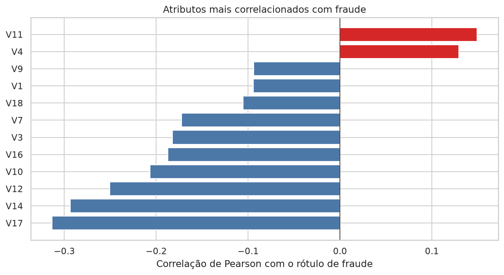
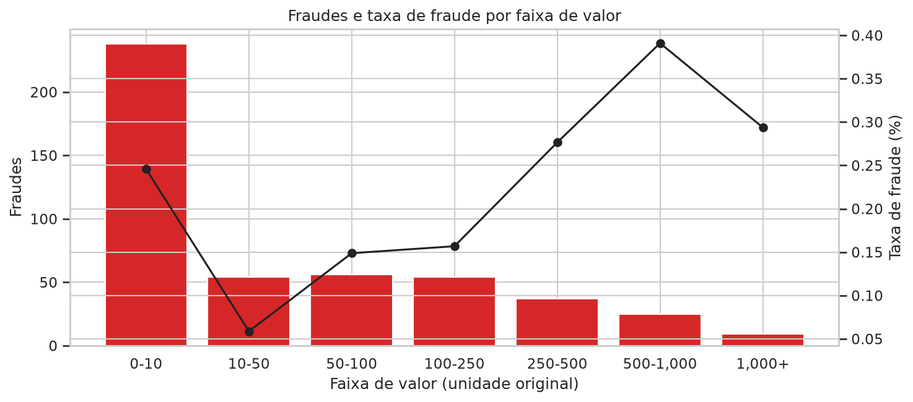
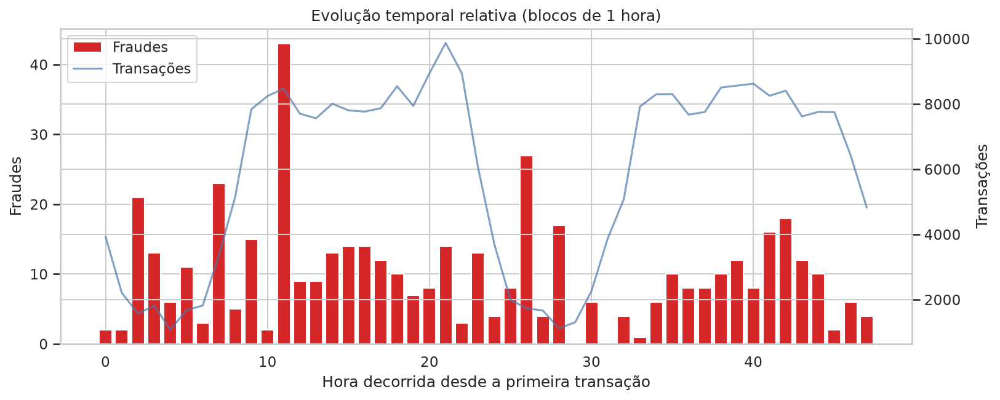
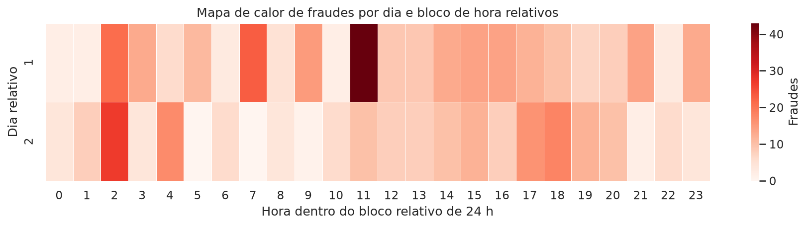

# Relatório de análise exploratória

**Base:** MLG/ULB — *Credit Card Fraud Detection*

**Arquivo preparado:** `data/processed/transacoes.parquet`

**Recorte:** 283.726 transações,
sendo 473 fraudes
(0,17%).

> **Limitações da base:** dois dias de transações, tempo relativo, atributos
> anonimizados por PCA e moeda não fixada no dicionário. As análises de tempo
> usam blocos relativos; não há data absoluta nem hora do dia confirmada.

## 1. Estatísticas gerais

| Indicador | Valor |
|---|---|
| Transações | 283.726 |
| Legítimas | 283.253 |
| Fraudulentas | 473 |
| Taxa de fraude | 0,17% |
| Valor total (unidade original) | 25.102.001,68 |
| Valor em fraudes | 58.591,39 |
| Valor mediano | 22,00 |
| Ticket médio | 88,47 |

### Distribuição das classes

| Classe | Transações | Participação |
|---|---|---|
| Legítima | 283.253 | 99,83% |
| Fraude | 473 | 0,17% |

## 2. OE-1 — Padrões e características das fraudes

| Indicador | Fraudulentas | Legítimas |
|---|---|---|
| Transações | 473 | 283.253 |
| Valor mediano | 9,82 | 22,00 |
| Valor médio | 123,87 | 88,41 |
| Transações com valor zero | 25 | 1.783 |

**Atributos mais correlacionados com o rótulo de fraude:**

| Atributo | Correlação |
|---|---|
| V17 | -0,313 |
| V14 | -0,293 |
| V12 | -0,251 |
| V10 | -0,207 |
| V16 | -0,187 |
| V3 | -0,182 |
| V7 | -0,172 |
| V11 | 0,149 |

**Leitura:** os atributos são componentes PCA anonimizados. A correlação indica
associação estatística na base, não um fator de negócio nomeável (R-06).

## 3. OE-2 — Fraudes por faixa de valor

| Faixa | Transações | Fraudes | Taxa de fraude | Valor movimentado |
|---|---|---|---|---|
| 0-10 | 96.873 | 238 | 0,25% | 358.665,58 |
| 10-50 | 91.937 | 54 | 0,06% | 2.308.317,54 |
| 50-100 | 37.640 | 56 | 0,15% | 2.704.688,21 |
| 100-250 | 34.437 | 54 | 0,16% | 5.370.732,58 |
| 250-500 | 13.380 | 37 | 0,28% | 4.595.870,57 |
| 500-1,000 | 6.395 | 25 | 0,39% | 4.327.084,13 |
| 1,000+ | 3.064 | 9 | 0,29% | 5.436.643,07 |

- 84,99% das fraudes têm valor até 250.
- 73,57% das fraudes têm valor até 100.

## 4. OE-3 — Fraudes ao longo do tempo

A base cobre 48 blocos de
1 hora desde a primeira transação. O horário de pico de fraudes é o bloco
11 (hora decorrida).

| Dia relativo | Fraudes |
|---|---|
| 1 | 272 |
| 2 | 201 |

## 5. Achados para a modelagem

- Desbalanceamento extremo: a classe positiva é rara, o que exige AUPRC,
  precision/recall e matriz de confusão — acurácia não é suficiente (R-03).
- `Amount` é assimétrico; a transformação visual usada é `log1p`, mas o modelo
  recebe o valor original padronizado no pipeline.
- As figuras temporais são relativas; nenhuma conclusão sobre sazonalidade ou
  horário real pode ser feita.
- Os valores extremos de `Amount` não foram removidos: fraudes aparecem nos
  extremos e a remoção poderia eliminar sinal.
