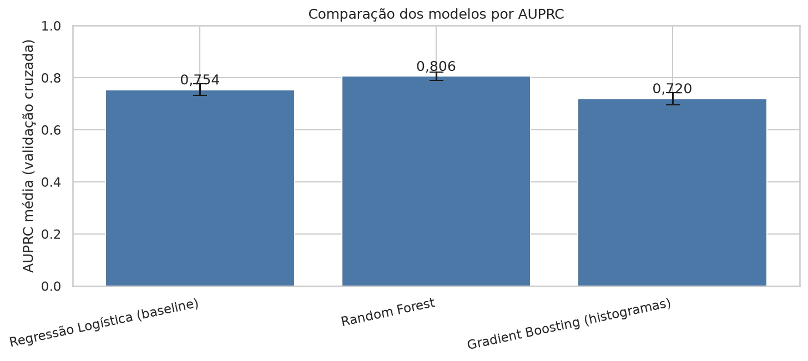
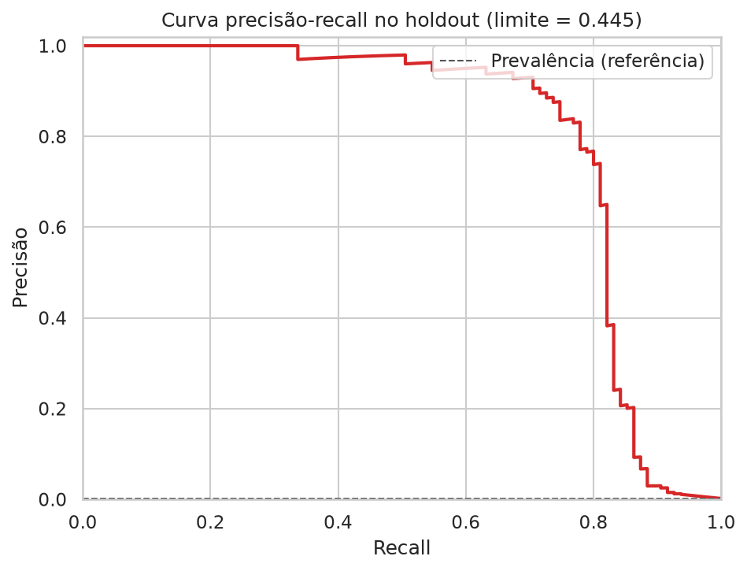
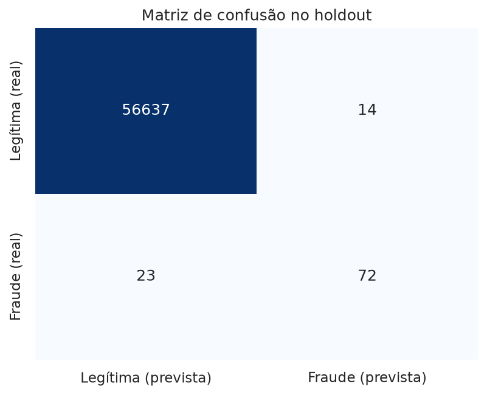
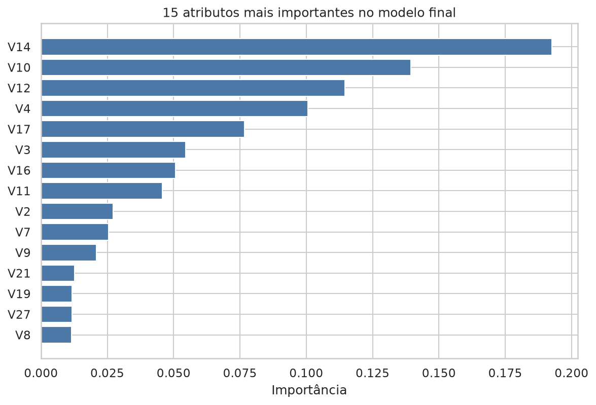

# Relatório de modelagem e avaliação

## 1. Configuração

| Item | Valor |
|---|---|
| Base | MLG/ULB preparada (`data/processed/transacoes.parquet`) |
| Atributos | `Time`, `V1`–`V28`, `Amount` (30 atributos) |
| Alvo | `Class` (1 = fraude) |
| Semente | 42 |
| Validação cruzada | 3 dobras estratificadas no treino |
| Modelo selecionado | Random Forest |
| Limite de decisão | 0,4447 |
| Origem do limite | probabilidades out-of-fold do treino, maximizando F1 |
| Desbalanceamento | `class_weight="balanced"` (sem reamostragem) |
| Split | estratificado, 20,00% para teste |

## 2. Comparação na validação cruzada (treino)

| Modelo | AUPRC | ROC-AUC | Precisão | Recall | F1 |
|---|---|---|---|---|---|
| Regressão Logística (baseline) | 0,754 ± 0,022 | 0,982 | 0,060 | 0,918 | 0,112 |
| Random Forest | 0,806 ± 0,017 | 0,965 | 0,841 | 0,810 | 0,824 |
| Gradient Boosting (histogramas) | 0,720 ± 0,024 | 0,950 | 0,459 | 0,839 | 0,592 |

A seleção usa a maior AUPRC média (R-05), não a acurácia. Na tabela de validação
cruzada, precisão, recall e F1 usam o limiar padrão de 0,5 apenas para comparação;
o modelo final é avaliado com o limiar escolhido no treino.

## 3. Avaliação no holdout

| Métrica | Valor |
|---|---|
| AUPRC | 0,7992 |
| ROC-AUC | 0,9592 |
| Precisão | 0,8372 |
| Recall | 0,7579 |
| F1 | 0,7956 |
| Acurácia (contexto) | 0,9993 |

- Prevalência no holdout (AUPRC de referência): 0,17%.
- Transações de teste: 56.746
  (95 fraudes).

| Matriz de confusão | Previsto legítima | Previsto fraude |
|---|---|---|
| Real legítima | 56.637 | 14 |
| Real fraude | 23 | 72 |

## 4. Fatores associados

| Atributo | Importância |
|---|---|
| V14 | 0,1926 |
| V10 | 0,1395 |
| V12 | 0,1145 |
| V4 | 0,1005 |
| V17 | 0,0767 |
| V3 | 0,0546 |
| V16 | 0,0508 |
| V11 | 0,0457 |
| V2 | 0,0273 |
| V7 | 0,0254 |

Os atributos são componentes PCA anonimizados. A importância indica contribuição
para o modelo nesta base, não um fator de negócio nomeável. `Time` é relativo e
`Amount` está na unidade original da base.

## 5. Limitações

- Base com dois dias, tempo relativo e atributos anonimizados: não há como
  interpretar causalidade nem afirmar sazonalidade.
- As duplicatas exatas foram removidas; o número de fraudes é menor que o do
  arquivo bruto e isso está documentado no relatório de qualidade.
- Poucos positivos tornam as métricas sensíveis ao split; a validação cruzada
  reduz, mas não elimina, essa instabilidade.
- O limite escolhido maximiza F1; um limite orientado a negócio pode privilegiar
  recall (menos fraudes perdidas) ao custo de mais falsos positivos.
- O modelo é acadêmico e não deve ser usado para bloqueio automático de
  transações.
